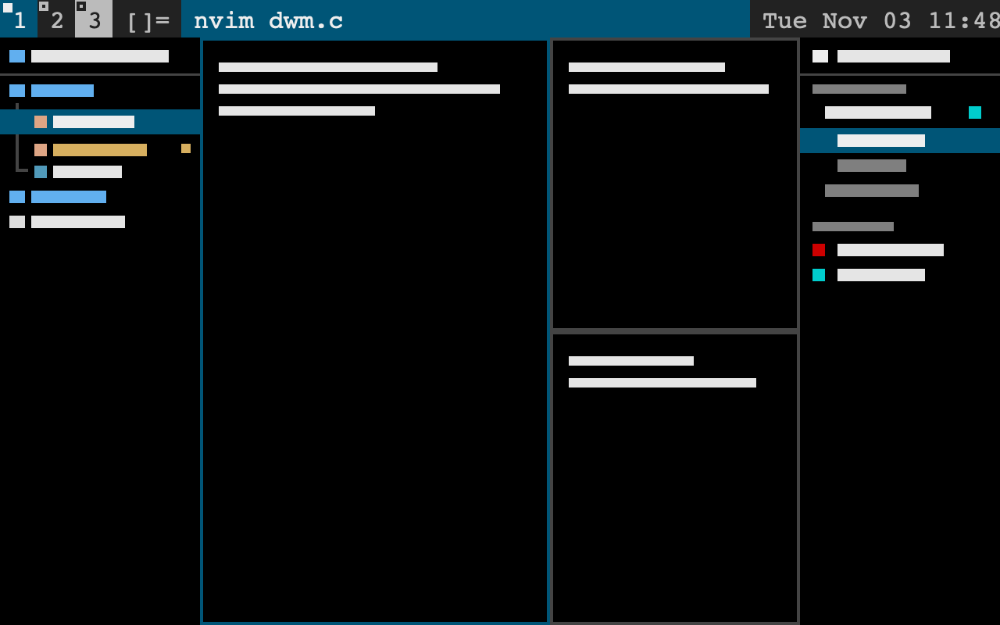
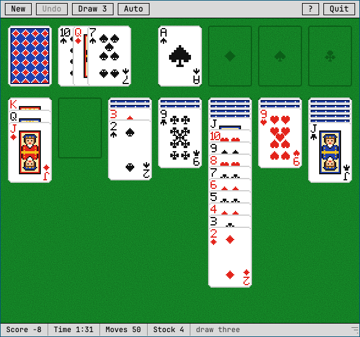

# herdr-dwm

A dwm-style layout for the [Herdr](https://herdr.dev) desktop app. A black-and-blue dwm bar runs across the top, with tags, the layout symbol, the focused title and a clock. Terminals tile master and stack below it. A neo-tree file tree sits on the left and a sessions-and-agents sidebar on the right. Around them are file previews, a reader-view browser, a port opener, a keyboard cheatsheet, and a pixel-art solitaire in a floating window.





## For agents: installing it

These steps follow the "Layouts and mods other people made" section of `~/.config/herdr-app/AGENTS.md`; read that first. The Herdr home is `~/.config/herdr-app`, or `$HERDR_APP_HOME` if set.

1. **Read every file here before writing anything.** Then tell the person what the mods do outside Herdr (see [What runs outside Herdr](#what-runs-outside-herdr)): they run programs, reach the network and read files.
2. **Check for name clashes.** This repo adds:
   - `layouts/dwm.json` and `layouts/dwm.svg`
   - `themes/dwm.json`
   - seven mods: `mods/dwm`, `mods/neotree`, `mods/sessions`, `mods/preview`, `mods/browser`, `mods/cheatsheet` and `mods/solitaire`

   Never overwrite one the person has. If a name is taken, rename the new one everywhere it's referenced (see [Names that refer to each other](#names-that-refer-to-each-other)).
3. **Copy each mod folder in one move.** If Herdr sees a mod's `main.js` before its `mod.json`, it docks the mod into the layout on screen and edits that layout file. So copy each folder into a temporary folder on the same disk first, then `mv` it into `mods/`:

   ```sh
   HOME_DIR=${HERDR_APP_HOME:-~/.config/herdr-app}
   STAGE=$(mktemp -d "$HOME_DIR/.stage-XXXX")
   for m in dwm neotree sessions preview browser cheatsheet solitaire; do
     cp -R "mods/$m" "$STAGE/$m" && mv "$STAGE/$m" "$HOME_DIR/mods/$m"
   done
   rmdir "$STAGE"
   cp layouts/dwm.json layouts/dwm.svg "$HOME_DIR/layouts/"
   cp themes/dwm.json "$HOME_DIR/themes/"
   ```
4. **Merge `keys.json`.** Add its `global` chords and its `layout:dwm` section into the person's own `keys.json`, and ask before replacing a key they already use.
   - **macOS:** the `alt-` keys need Option to act as Alt. That's the default (`option_as_alt: "auto"`) on US, ABC and similar keyboard layouts; on others, set `option_as_alt` in `settings.json`.
   - **Linux and Windows:** `cmd` is the Super key, so you may want to rebind the `cmd-k` chords to a free chord such as `ctrl-alt-k`.
5. **Check each mod:** run `herdr-app check "$HOME_DIR/mods/<name>"` for all seven, and fix anything that fails before going on.
6. **Switch to the layout:** `herdr-app do layout.switch --name dwm`. The person's own layout stays as it was, and `ctrl-shift-l` switches back.

To remove it, delete the files listed in step 2 and the merged keys.

## What's in it

| Part | Mod | What it does |
|---|---|---|
| Bar and launcher | `dwm` | The top bar: one tag per tab, the layout symbol (`[]=` tiled or `[n]` monocle), the focused pane's title, and the space name with a clock. `alt-p` opens dmenu, which runs any program on `$PATH` in a new pane. New panes tile the dwm way: master on the left, the stack on the right. |
| File tree | `neotree` | The left sidebar, in the style of neo-tree. It shows the shown tab's folder with indent markers, Nerd Font file icons and git status. Files open in the tab's vim or nvim if one is running, otherwise in a new editor pane. Images, PDFs, video and documents open in a preview instead. It works on remote machines too. |
| Sessions and agents | `sessions` | The right sidebar. Spaces are grouped by machine, with their tabs under them. Agents are sorted by urgency, with their sub-agents nested. Background terminals that no space shows are listed too, along with the ports servers are listening on in each tab. From here you can create, rename, close, reorder, peek, pin and kill. |
| Preview | `preview` | Shows a file: images with zoom, PDFs as scrolling pages, markdown and HTML rendered, code in a read-only editor, and anything else as a thumbnail. It opens either in a pane or in a floating window that follows the tree's cursor. |
| Browser | `browser` | A reader-view browser drawn by Herdr. It fetches pages with curl and shows their main content with links, back and forward history, and search. It doesn't run JavaScript or CSS. |
| Port opener | `sessions` | Notices when a program in a terminal starts listening on a port and posts a notification that opens the page. Ports on another machine are forwarded to this one over ssh. |
| Cheatsheet | `cheatsheet` | Every key in one dialog: Herdr's own, this layout's, and the ones inside the sidebars and the browser. You can type to filter. |
| Solitaire | `solitaire` | Klondike in a floating window: pixel-art cards on felt, with an old X11-style button bar. Drag the corner grip to resize it. The game is saved as you play. |

### Keys

With the dwm layout shown (`layout:dwm`):

| Key | Does |
|---|---|
| `alt-p` | dmenu: run a program |
| `alt-shift-enter` | New terminal, placed as master or stack |
| `alt-j` / `alt-k` | Focus the next / previous pane |
| `alt-enter` | Swap the focused pane with the master |
| `alt-t` / `alt-m` / `alt-space` | Tile / monocle / zoom |
| `alt-1` … `alt-9`, `alt-tab` | Go to a tab, or back to the last one |
| `alt-,` / `alt-.` | Previous / next space |
| `alt-b` | Toggle the bar |
| `alt-shift-c` / `alt-shift-q` | Close the pane / close the window |
| `alt-e` / `alt-s` | Open, focus or close the file tree / the sessions sidebar |
| `alt-h` / `alt-l` | Move focus into a sidebar and back out |

Everywhere (`global`):

| Key | Does |
|---|---|
| `⌘K K` or `⌘K ⌘K` | Cheatsheet |
| `⌘K B` | Browser in a new tab |
| `⌘K P` | Open the current tab's port in the browser |
| `⌘K G` | Solitaire |

Inside the file tree, the sessions sidebar and the browser, `?` lists their own keys, and the cheatsheet lists them all.

## What runs outside Herdr

Tell the person this before installing:

- **File tree:**
  - lists folders with `sh`, on the space's machine
  - runs `git status` there
  - creates, moves, copies and trashes files when asked (using `trash`, `gio trash` or `trash-put`; it never deletes permanently)
  - copies paths to the clipboard (`pbcopy`, `wl-copy` or `xclip`)
  - types into a vim or nvim terminal to open a file (`hc keys` and `hc send`)
- **Preview:**
  - reads the file and runs `file` and `ls` on it
  - copies files from another machine with `hc exec … cat`
  - makes thumbnails with `qlmanage` (macOS), `pdftoppm` or `ffmpeg`
  - on macOS without `pdftoppm`, builds `pdfpages.swift` once with `swiftc` to render PDF pages
  - keeps copies and thumbnails in `mods/preview/.cache/` for a week
- **Browser:** fetches pages from the network with `curl` and keeps them in `mods/browser/.cache/` for a day. `O` opens a page with `open` or `xdg-open`.
- **Sessions:**
  - every 5 seconds, lists listening sockets (`ss` or `lsof`) and processes (`ps`) on each machine that has a terminal
  - looks up each terminal's process with `hc get`
  - for a port on another machine, starts `ssh -N -L` in a background core terminal labelled `herdr.port-forward`, using the target from `hc machine ls`, and kills it when the port closes
  - runs `hostname`
- **Bar:** dmenu lists the programs on `$PATH` and runs the one picked.

## Requirements

- **Herdr:** the Herdr app 0.1.13 or later, on macOS or Linux. Built and tested on 0.1.13 on macOS.
- **Programs used:** `curl`, `git`, `ssh`, `lsof` or `ss`, and `file`.
- **Optional extras:** `pdftoppm` or Xcode's `swiftc` for PDF pages, and a trash command for deleting from the tree.
- **Icons:** the Nerd Font icons come from the Symbols Nerd Font that ships with Herdr.

## Names that refer to each other

If you rename a mod, change these references too:

- **`layouts/dwm.json`:** names the `dwm`, `neotree` and `sessions` mods, and the blocks `tree` and `sessions` (passed to those mods as `props.block`).
- **`keys.json`:**
  - mod opens: `mod.open:dwm`, `mod.open:cheatsheet`, `mod.open:solitaire`
  - mod commands: `dwm.*`, `neotree.toggle`, `sessions.toggle`, `sessions.port`
  - the browser binding: `tab.new` with `mod: "browser"`
- **Mods that open other mods:**
  - `neotree` opens `preview`, as a pane and as the floating window `neotree-preview`
  - `sessions` opens `browser`, from port rows and notifications
- **Asset paths:**
  - `preview` and `browser` cache under `mods/<name>/.cache`
  - `solitaire` draws from `mods/solitaire/px/`
- **Cheatsheet:** it reads the keys the other mods publish as the shared values `cheatsheet.neotree`, `cheatsheet.sessions` and `cheatsheet.browser`.
- **Other shared values:** `neotree.preview`, `ports`, `solitaire.game`, `solitaire.draw` and `solitaire.scale`.

## Limits

- **Browser:** it can't run JavaScript or CSS. Apps that draw themselves with JavaScript (a Vite or Next dev server) get a notice and `O` to open them in the system browser.
- **Port opener:** it ignores ports at 32768 and above, where tools keep their internal sockets, and Node's debugger on 9229.
- **PDFs:** the preview shows the first 40 pages.
- **Previews from another machine:** files over 64 MB aren't copied.
- **Solitaire:** it scales between 1 and 4 screen pixels per art pixel, in half steps. `px/make.py` redraws its art from the bitmaps inside it.

## License

Apache-2.0, the same as Herdr. The solitaire rules and its click and drag handling are adapted from Herdr's own `mods/win98/sol.js`.
