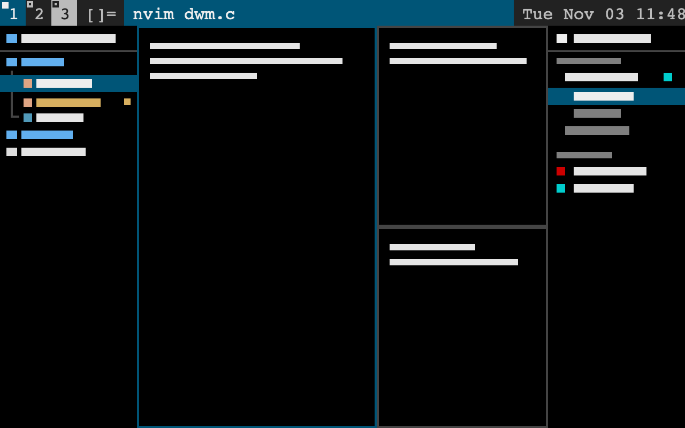

# dwm

A dwm desktop inside Herdr. An 18px black bar runs across the top, with numbered tags in dwm blue. Below it, terminals tile master and stack with 1px borders. A neo-tree file tree is on the left and a sessions-and-agents sidebar on the right. Files preview in a pane or a floating window, a reader-view browser opens in a tab, a notification offers each new port, and `⌘K` chords open a cheatsheet and a pixel-art solitaire.

## What you see

The look throughout:

- **Theme:** `themes/dwm.json`. Background `#000000`, chrome `#222222`, foreground `#bbbbbb`, border `#444444`, accent and selection `#005577`, accent foreground `#eeeeee`.
- **Font:** JetBrains Mono for the UI. The title bar is hidden (`titlebar: "none"`, macOS traffic lights at 6, 2).

Top to bottom, left to right:

- **Bar** (18px, `dwm` mod, `role: "bar"`, draggable to move the window):
  - one tag per tab: the selected tab in `#005577` / `#eeeeee`, the others `#222222` / `#bbbbbb`
  - a 4px square on a tag: filled for the focused tab, an outline otherwise; a blocked or finished agent inverts the tag
  - `[]=` (tiled) or `[n]` (monocle with n panes), then the focused pane's title, filling the bar in `#005577` while a pane has focus
  - on the right, `space name | Thu Nov 05 18:02`
- **File tree** (block `tree`, 240px, `neotree` mod):
  - a header with the folder path, using `~` for home, and the git branch
  - rows 20px tall, with neo-tree's `│` / `└` indent guides drawn as 1px lines in the theme border
  - Symbols Nerd Font icons: folders closed / open / empty in `#61afef`, files in their devicon colours
  - git status on the right in neo-tree's colours: modified `#d7af5f`, added `#5faf5f`, deleted `#ff5900`, untracked and conflicted `#ff8700`. Folders take the most urgent status inside them.
  - dotfiles and git-ignored files hidden; `H` shows them dimmed
  - the cursor row is `#005577` while the tree has focus and the theme's raised colour otherwise
- **Terminals** (block `main`): the active tab, with no gap, a 1px border in the border colour and an accent border when focused. A lone pane is framed too.
- **Sessions** (block `sessions`, 260px, `sessions` mod):
  - **Machines:** a laptop icon for this one (named with `hostname -s`), a server icon for others. Each lists its spaces, with a chevron, bold when active, the git branch, a status glyph, and collapsed ports in cyan (`:5173`). Under each space are its tabs (index, program icon, name, status) and port rows (`localhost:<port>`, process name or `machine:port`).
  - **Agents:** pinned first, then blocked, done, working, idle. Each shows a spinner or glyph, the program icon, the space name, the tab name or program, the machine, and minutes working. Sub-agents are nested with guides.
  - **Detached:** live core terminals that no pane shows, only when there are any.

## How it behaves

- **Agent status:** working is a spinning ring (the shipped `mods/workspace-chrome/spinner.svg`); blocked is a `t.blocked` exclamation mark; done is a `t.done` check; idle is a `t.idle` ring. The agents header counts blocked agents ("2 need you"). Agents are ordered for `agent.next` with `setAgentOrder`.
- **Sidebars:**
  - **Opening and closing:** `alt-e` / `alt-s` open a closed sidebar and focus it. Pressed in the focused sidebar, the same key closes it by resizing its block to 0 px (`layout.resize`), not hiding it. Hidden blocks don't get mod commands, a resized one does.
  - **Focus:** `alt-h` / `alt-l` are `pane.go`, and both mods are `focusable`.
  - **Following the terminal:** the tree's root is the folder of the terminal last focused in the shown tab, and follows `cd`.
  - **Keys inside:** both take neo-tree-style keys, listed by `?` in each.
- **Opening files from the tree:** `enter` on a file:
  - **vim or nvim already in the tab:** the tree types `esc esc g shift+q` (Ex mode; `hc keys` can't type `:`), then `hide edit <escaped path>`, then `visual`, using `hc keys` and `hc send`.
  - **No editor running:** a new pane runs `$VISUAL`, `$EDITOR`, nvim, vim or vi, split right of a lone pane or below the last one, the way dwm places clients.
  - **Media files** (images, pdf, video, audio, office documents, fonts) open a `preview` pane instead.
  - **Other keys:** `P` toggles a floating `preview` window (`key: "neotree-preview"`) that follows the cursor through `shared("neotree.preview")`. `O` opens the file in the system app.
- **Preview:**
  - **Images:** `image()` from a copy in `.cache`, with `− fit +` header buttons (fit, 150%, 200%, 300%, 400%) in a both-ways scroll area.
  - **PDFs:** pages as PNGs, from `pdftoppm`, or from `pdfpages.swift` built with `swiftc`.
  - **Markdown and HTML:** `TextView`.
  - **Text:** a read-only `Editor`.
  - **Anything else:** a Quick Look, `pdftoppm` or `ffmpeg` thumbnail.
- **Browser:**
  - **Fetching:** `curl -sSL` into `.cache`, which reports the content type, the final address and the status.
  - **Reader view:** it drops scripts, styles and chrome elements (classes, ids or roles naming nav, menu, toc, footer, sidebar and so on, except on `html`, `body`, `main` and `article`), makes every `href` and `src` absolute, and shows the result with `TextView.html`.
  - **Navigation:** clicked links open in place, with back and forward. Text that isn't an address searches `lite.duckduckgo.com`.
- **Ports:** every 5 seconds the sessions mod lists each machine's listening sockets and process parents, and finds the terminal each port descends from.
  - **Ignored ports:** 32768 and above, and 9229.
  - **Another machine:** the port gets `ssh -N -L 127.0.0.1:<free>:localhost:<port> <target>` in an `hc run --bg` terminal labelled `herdr.port-forward=<machine>:<port>:<local>`, killed when the port closes.
  - **New ports:** a port that appears after the first scan posts a notification whose action is `tab.new {mod: "browser", props: {url}}`.
  - **`⌘K P`** opens the current tab's port beside its terminal.
- **Cheatsheet** (`mod.open:cheatsheet`, a dialog of 0.82 × 0.86): it groups `keys()` by section, merges the keys of each action, writes them as `⌘⇧]`, and adds the keys the mods publish in `shared("cheatsheet.<mod>")`. Typing filters it; `esc` clears the filter or closes.
- **Solitaire** (`mod.open:solitaire`, a frameless window keyed `solitaire`):
  - **The game:** Klondike, with draw 1 or 3 and standard scoring. Moves are click-then-click, drag, or double-click to send home.
  - **Keys:** `n` new, `u` undo, `d` draw mode, `a` auto-finish, `+` and `-` size, `?` help, `q` quit.
  - **Look:** a 1px `#005577` border, a `#d9d9d9` Athena-style button row and status bar, and felt `#16912a` with grain.
  - **The art:** cards are a 36 × 50 pixel-art grid with notched corners. It has pixel ranks and suits (the lower index and lower pips flipped), pip layouts for 2 to 10, and a large ace. Court cards are mirrored King, Queen and Jack portraits with robes in the suit colour. The back is red-cored diamonds on blue.

## Built from

- **Layout:** `layouts/dwm.json`. Its root column holds:
  - the `bar` block (18px, `window_drag`)
  - a `body` row of `tree` (240, max 600, `{mod: "neotree", props: {block: "tree"}}`), `main` (`{tab: "active"}`) and `sessions` (260, max 600)
- **Mods:**
  - `dwm` (`main.js` picks `bar.js` or `dmenu.js` by props)
  - `neotree` (`icons.js` for glyphs and colours)
  - `sessions` (`ports.js`)
  - `preview` (`pdfpages.swift`)
  - `browser`
  - `cheatsheet`
  - `solitaire` (`px/make.py` writes the SVGs in `px/`)
- **Shipped mods used:** `mods/workspace-chrome/spinner.svg` and program icons from `icons/`.
- **Herdr functions:**
  - data: `spaces`, `machines`, `panes`, `agents`, `terminals`, `focused`, `theme`, `settings`, `keys`
  - running things: `exec` (with `on`), `hc`, `run`, `readTextFile`, `watchFolder`, `knownAgents`
  - shared state and overlays: `shared`, `setShared`, `setAgentOrder`, `notify`, `openOverlay`, `closeOverlay`, `nextCommand`, `props`, `appHome`
- **Commands:**
  - spaces: `space.new`, `space.select`, `space.rename`, `space.close`, `space.move`
  - tabs: `tab.new`, `tab.select`, `tab.rename`, `tab.close`, `tab.move`
  - panes: `pane.split`, `pane.focus`, `pane.go`, `pane.zoom`, `pane.close`
  - terminals: `terminal.peek`, `terminal.keep`, `terminal.kill`, `terminal.pin`
  - layout: `layout.resize`, `layout.switch`
- **Programs:** `sh`, `git`, `curl`, `ssh`, `ss` or `lsof`, `ps`, `file`, `ls`, `trash`, `gio` or `trash-put`, `qlmanage`, `pdftoppm`, `ffmpeg`, `swiftc`, and `pbcopy`, `wl-copy` or `xclip`.

## Watch out

- **Copying mods:** write a mod's `mod.json` before its `main.js`, or move the whole folder in at once. A `main.js` alone gets docked into the shown layout (a new row around it), which rewrites the layout file.
- **Don't name a method `close()`.** Herdr calls a view's `close()` as cleanup on reload and teardown. A `close()` that hides a sidebar collapses it on every reload.
- **Zoom and pointer positions:** Herdr's zoom (`settings.json`) scales everything a mod draws, but pointer events arrive in screen pixels. Convert with the element's own bounds: `(position - bounds.origin) × layoutWidth / bounds.width`. Don't use `local_position` or `position - bounds` as layout pixels. For crisp pixel art, divide sizes by the zoom, as `mods/win98/kit.js` does.
- **Virtual list rows** can't have handlers. Use `on_item_click` on the list.
- **`hc keys`** only takes unshifted key names, so vim's `:` is reached through `gQ` Ex mode.
- **Floating windows** only get mouse moves while the pointer is over them. The solitaire grip adds a clear 400px margin while it's held, so resizing keeps working past the edge.
- **`shell` scripts in `exec`:** end them with a command that succeeds, or a final `[ ... ] && break` makes the script exit 1.
- **The browser** is reader-only: there's no JavaScript or CSS. Pages that draw themselves with JavaScript show a notice offering `O`.
- **Remote ports** need `ssh <machine target>` to work without a password, because the tunnel runs with `BatchMode=yes`.

## Done when

- **Layout:** `herdr-app check` passes for all seven mods, and `layout.switch dwm` shows the bar, the tree on the left, the terminals and sessions on the right.
- **Sidebars:**
  - `alt-e` / `alt-s` open, focus and close each sidebar, and reloading a mod doesn't collapse it.
  - the tree follows a `cd`, shows git status, and opens a file in a running nvim with `enter`
- **Previews:**
  - `enter` on a png and a pdf opens a preview pane: the pdf scrolls through its pages and `+` zooms the image
  - `P` opens the floating preview, which changes as the cursor moves
- **Ports and browser:** starting `python3 -m http.server 8765` in a terminal posts "localhost:8765 is up" within 5 seconds, with a port row under the tab, and the browser shows the directory listing.
- **Cheatsheet:** `⌘K K` lists every section and filters as you type.
- **Solitaire:** `⌘K G` opens it, a dragged card stays under the pointer at the spot it was grabbed (also at zoom 1.1), and the corner grip resizes it.
